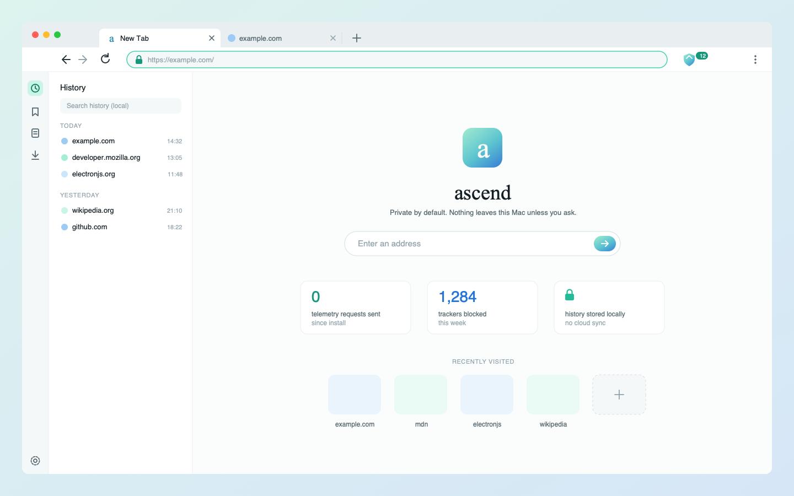

<p align="center">
  
</p>

<h1 align="center">ascend</h1>

<p align="center">
  A private browser for macOS that keeps everything on your Mac.<br>
  No telemetry. No accounts. No cloud.
</p>

<p align="center">
  
</p>

> [!NOTE]
> ascend is in early development and can't browse yet. The foundation is in
> place; the first working window comes in Phase 2. See the
> [roadmap](ROADMAP.md).

## Why ascend

Most browsers send something home: usage statistics, crash reports, update
checks, search suggestions, fonts from a CDN. ascend sends nothing you didn't
ask for. Your history, bookmarks and settings live in one folder on your Mac
and never leave it.

## Privacy rules

These five rules apply to the browser, its build scripts and every
dependency. A change that breaks one of them doesn't ship.

| Rule                   | What it means                                                                   |
| ---------------------- | ------------------------------------------------------------------------------- |
| Zero telemetry         | No usage data, ever.                                                            |
| No silent requests     | Update checks, crash reports, filter lists and fonts only load after you agree. |
| Local data only        | History, bookmarks and settings stay on this Mac. No sync.                      |
| HTTPS only             | Pages load over HTTPS by default.                                               |
| Ads and trackers block | Brave's `adblock-rust` with EasyList and EasyPrivacy (Phase 3).                 |

Crash reports are saved locally. You decide whether to share one, by exporting
it yourself.

## Roadmap

| Phase | Focus                                               | Status  |
| ----: | --------------------------------------------------- | ------- |
|     1 | Project foundation, tooling, design                 | Done    |
|     2 | First window: tabs, address bar, local history      | Next    |
|     3 | Ad and tracker blocking, enforced HTTPS             | Planned |
|     4 | Per-site isolation, containers, anti-fingerprinting | Planned |
|    4b | Encrypted profile data (SQLCipher, macOS Keychain)  | Planned |
|     5 | Side panels, themes, keyboard shortcuts             | Planned |
|     6 | Full network audit of the built app                 | Planned |
|     7 | Signed app, manual or self-hosted updates           | Planned |
|     8 | Optional local AI, running on this Mac only         | Planned |

Details for each phase are in [ROADMAP.md](ROADMAP.md).

## Getting started

You need:

- A Mac with Apple silicon
- Node.js 24, pinned in [`.node-version`](.node-version). [fnm](https://github.com/Schniz/fnm) picks it up automatically.
- Xcode Command Line Tools: `xcode-select --install`

Then, in the project folder:

```sh
npm install
git config core.hooksPath .githooks
npm run check
```

`npm run check` runs the type checker, the linter and the formatter check. The
second line turns on a commit hook that stops personal data (names, email
addresses, home-folder paths, IP addresses) from entering the history.

Running the browser itself comes with Phase 2.

### Network access during setup

Only setup touches the network, and only when you run it:

- `npm install` downloads packages from the npm registry.
- From Phase 2, the `electron` package downloads its prebuilt binary from
  GitHub.

## Project layout

```text
.claude/      Agents, hooks and skills for Claude Code
.githooks/    Commit hook that keeps personal data out of the repo
design/       Logo, design tokens, window template, style guide
build/        App icon (.icns) for packaging
src/          Source code (grows from Phase 2)
```

## Design

A large white Times New Roman “a”, cropped by a flat mint tile and pressed in.
The interface uses six flat colours, SF Pro for text and Times for display.
Everything is in [`design/`](design/README.md).

## License

[Mozilla Public License 2.0](LICENSE)
