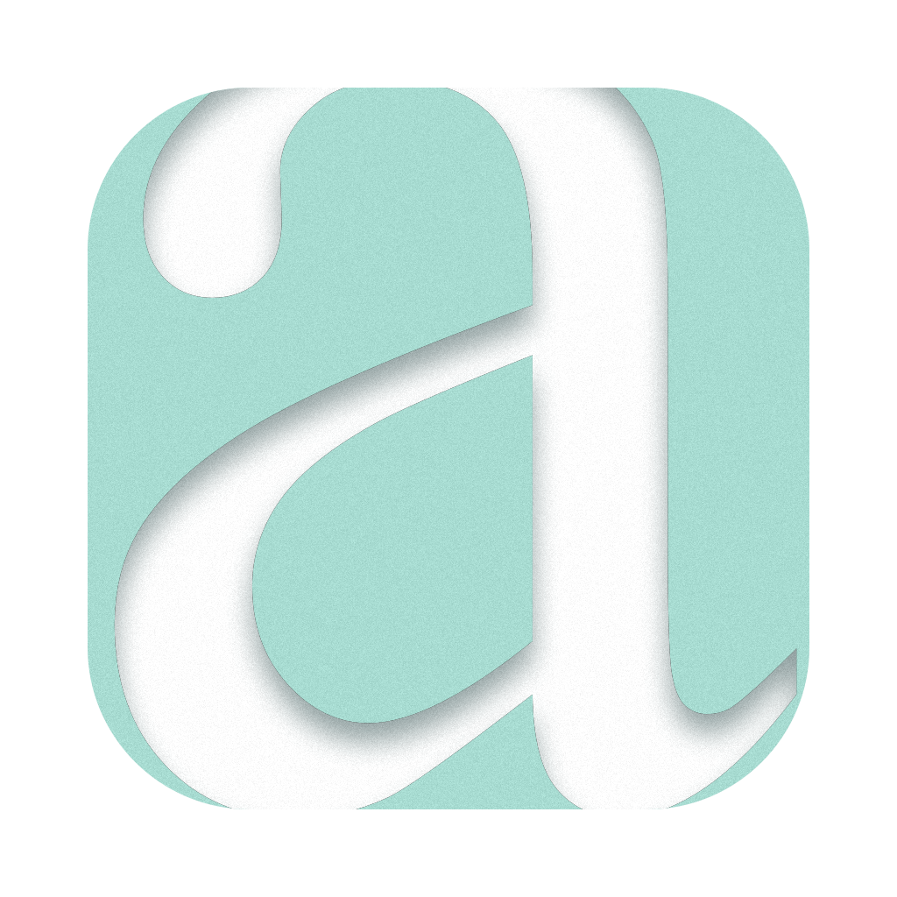

<p align="center">
  
</p>

<h1 align="center">ascend</h1>

<p align="center">
  Track what you eat. Calories and nutrients, on your phone and your computer.<br>
  Offline first. No account. No tracking.
</p>

> [!NOTE]
> ascend is in early development. The project foundation is in place; the
> first version of the app is being built. See the [roadmap](ROADMAP.md).

## What ascend does

- **Log your food:** name, portion, calories, protein, carbohydrates and fat.
- **Set your own daily goals:** ascend suggests no numbers; you decide.
- **Works offline:** everything runs on your device, with or without a
  connection. Enter nutrition values by hand anytime.
- **Look things up when you want to:** search for a food or scan a barcode to
  fill in values from [Open Food Facts](https://world.openfoodfacts.org).
  Results are saved on your device for next time.
- **Phone first, dashboard on the computer:** quick logging on the iPhone, a
  wider view of days and weeks in the browser.

## Privacy

| Rule                      | What it means                                                               |
| ------------------------- | --------------------------------------------------------------------------- |
| No telemetry              | ascend never sends usage data, crash reports or analytics.                  |
| Your data stays with you  | Everything is stored on your device. There's no account and no cloud.       |
| You trigger every request | ascend contacts Open Food Facts only when you tap search or scan a barcode. |
| Nothing from a CDN        | Fonts are system fonts; every other asset ships with the app.               |

When you search or scan, Open Food Facts sees the search term or barcode and
your IP address. ascend sends nothing else.

## How it's built

ascend is a progressive web app (PWA): a website you add to your home screen
that then works like an app, including offline.

- TypeScript and Vite, no UI framework
- IndexedDB (via Dexie) for local storage
- A service worker for offline use
- Barcode scanning with a self-hosted WebAssembly decoder
- Tests with Vitest and Playwright (iPhone size, desktop, offline)

You don't need Xcode, Swift, Android Studio or a developer account to build or
use it.

## Getting started

You need a Mac or PC with Node.js 24 (pinned in [`.node-version`](.node-version);
[fnm](https://github.com/Schniz/fnm) picks it up automatically).

```sh
npm install
git config core.hooksPath .githooks
npm run check
```

`npm run check` runs the type checker, the linter and the formatter check. The
second line turns on a commit hook that keeps personal data (names, email
addresses, home-folder paths, IP addresses) out of the history.

Commands to run the app follow with the app skeleton in Phase 2.

## Project layout

```text
.claude/      Agents, hooks and skills for Claude Code
.githooks/    Commit hook that keeps personal data out of the repo
design/       Logo, design tokens and the design history
build/        App icon (.icns)
src/          App source code (from Phase 2)
tests/        Unit and end-to-end tests (from Phase 2)
```

## Design

The mark is a large white Times New Roman “a”, cropped by a flat mint tile. The
interface uses flat colours and system fonts. Everything is in
[`design/`](design/README.md), including how the identity evolved.

## Data source

Food data comes from Open Food Facts. Contains data from Open Food Facts,
available under the [Open Database License](https://opendatacommons.org/licenses/odbl/1-0/).

## License

[Mozilla Public License 2.0](LICENSE)
