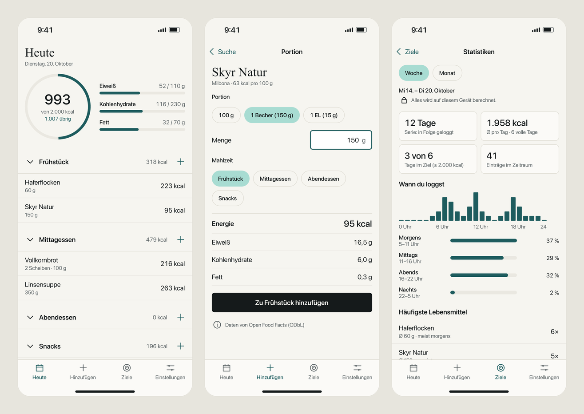
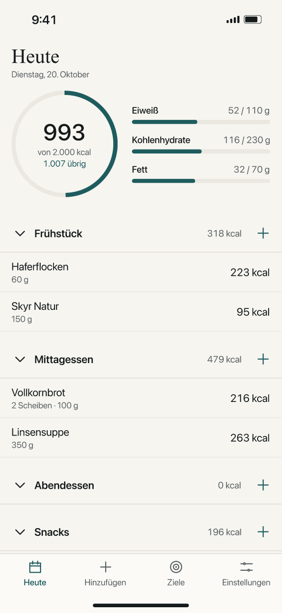
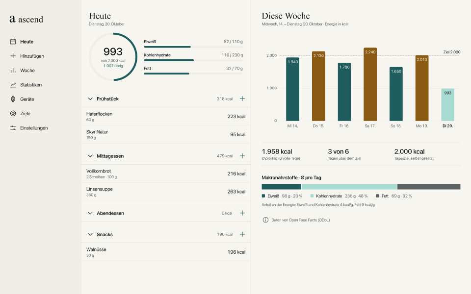

<p align="center">
  
</p>

<h1 align="center">ascend</h1>

<p align="center">
  Track what you eat. Calories and nutrients, on your phone and your computer.
</p>

<p align="center">
  
</p>

> [!NOTE]
> ascend is in early development. The app skeleton runs and works offline; the
> screens above come from the interactive design prototype. See the
> [roadmap](ROADMAP.md).

## What ascend does

- **Log your food:** name, portion, calories, protein, carbohydrates and fat.
- **Set your own daily goals:** ascend suggests no numbers; you decide.
- **Works offline:** log anything without a connection, anytime.
- **Look things up when you want to:** search for a food or scan a barcode to
  fill in values from [Open Food Facts](https://world.openfoodfacts.org).
  Results are saved on your device for next time.
- **See your patterns:** when you log, streaks, weekly averages and your most
  frequent foods, computed on your device.
- **Phone first, dashboard on the computer:** quick logging on the iPhone, a
  wider view of days, weeks and activities in the browser.
- **Planned:** a private account without an email address for encrypted sync
  between your devices, and connections to Strava and Apple Health.

<table>
  <tr>
    <td align="center" width="34%">
      
      <br><sub>Adding food fills the ring</sub>
    </td>
    <td align="center" width="66%">
      
      <br><sub>The dashboard on the computer</sub>
    </td>
  </tr>
</table>

## Privacy

| Rule                      | What it means                                                               |
| ------------------------- | --------------------------------------------------------------------------- |
| No telemetry              | ascend never sends usage data, crash reports or analytics.                  |
| Your data stays with you  | Everything is stored on your device first and works without a connection.   |
| You trigger every request | ascend contacts Open Food Facts only when you tap search or scan a barcode. |
| Nothing from a CDN        | Fonts are system fonts; every other asset ships with the app.               |

When you search or scan, Open Food Facts sees the search term or barcode and
your IP address. ascend sends nothing else.

The planned account follows the same idea: no email, no name, nothing about
you. Your data is encrypted on your device before it syncs, so the server only
stores what it can't read. The details are in
[`docs/design/account-and-sync.md`](docs/design/account-and-sync.md).

## How it's built

ascend is a progressive web app (PWA): a website you add to your home screen
that then works like an app, including offline.

- TypeScript and Vite, no UI framework
- IndexedDB (via Dexie) for local storage
- A service worker for offline use
- Barcode scanning with a self-hosted WebAssembly decoder (Phase 4)
- Tests with Vitest and Playwright (iPhone size, desktop, offline)

You don't need Xcode, Swift, Android Studio or a developer account to build or
use it.

## Getting started

You need a Mac or PC with Node.js 24 (pinned in [`.node-version`](.node-version);
[fnm](https://github.com/Schniz/fnm) picks it up automatically).

```sh
npm install
git config core.hooksPath .githooks
npm run dev
```

The second line turns on a commit hook that keeps personal data (names, email
addresses, home-folder paths, IP addresses) out of the history. `npm run dev`
starts the app on `localhost`.

| Command                  | What it does                                                        |
| ------------------------ | ------------------------------------------------------------------- |
| `npm run dev`            | Start the development server                                        |
| `npm test`               | Run the unit tests (Vitest)                                         |
| `npx playwright install` | Download the test browsers once (WebKit and Chromium)               |
| `npm run test:e2e`       | Run the end-to-end tests: iPhone size, desktop and offline          |
| `npm run verify`         | Type check, lint, format check, unit tests, build and the URL check |

## Project layout

```text
src/          App source code: i18n, database, app shell, styles
tests/        Unit tests (Vitest) and end-to-end tests (Playwright)
public/       App icons
scripts/      Icon generation and the check that the build contacts no one
docs/design/  Design documents for each phase
design/       Logo, design tokens, the FigCraft prototype and the design history
build/        App icon (.icns)
.claude/      Agents, hooks and skills for Claude Code
.githooks/    Commit hook that keeps personal data out of the repo
```

## Design

The mark is a large white Times New Roman “a”, cropped by a grainy mint tile.
The interface uses flat colours and system fonts.

The whole app is designed as a clickable prototype in
[FigCraft](https://github.com/storytold/figcraft):
[`design/figcraft/ascend-app.figcraft`](design/figcraft/ascend-app.figcraft).
Open it, choose **Prototype → Present**, and pick a flow; the page
“Demo-Anleitung” explains each one. Everything else, including how the
identity evolved, is in [`design/`](design/README.md).

## Data source

Food data comes from Open Food Facts. Contains data from Open Food Facts,
available under the [Open Database License](https://opendatacommons.org/licenses/odbl/1-0/).

## License

[Mozilla Public License 2.0](LICENSE)
