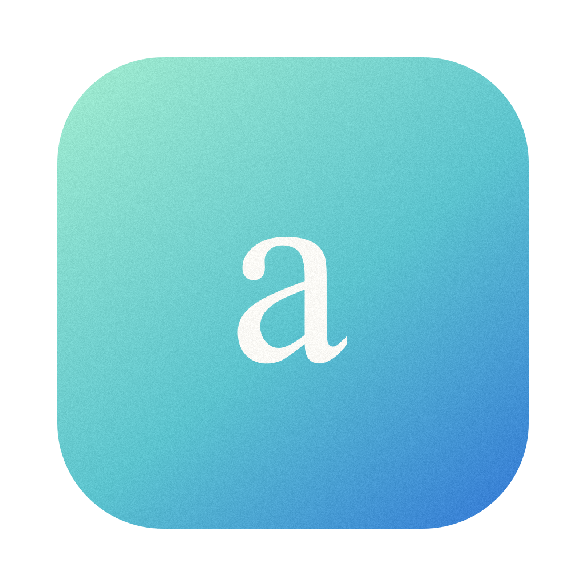
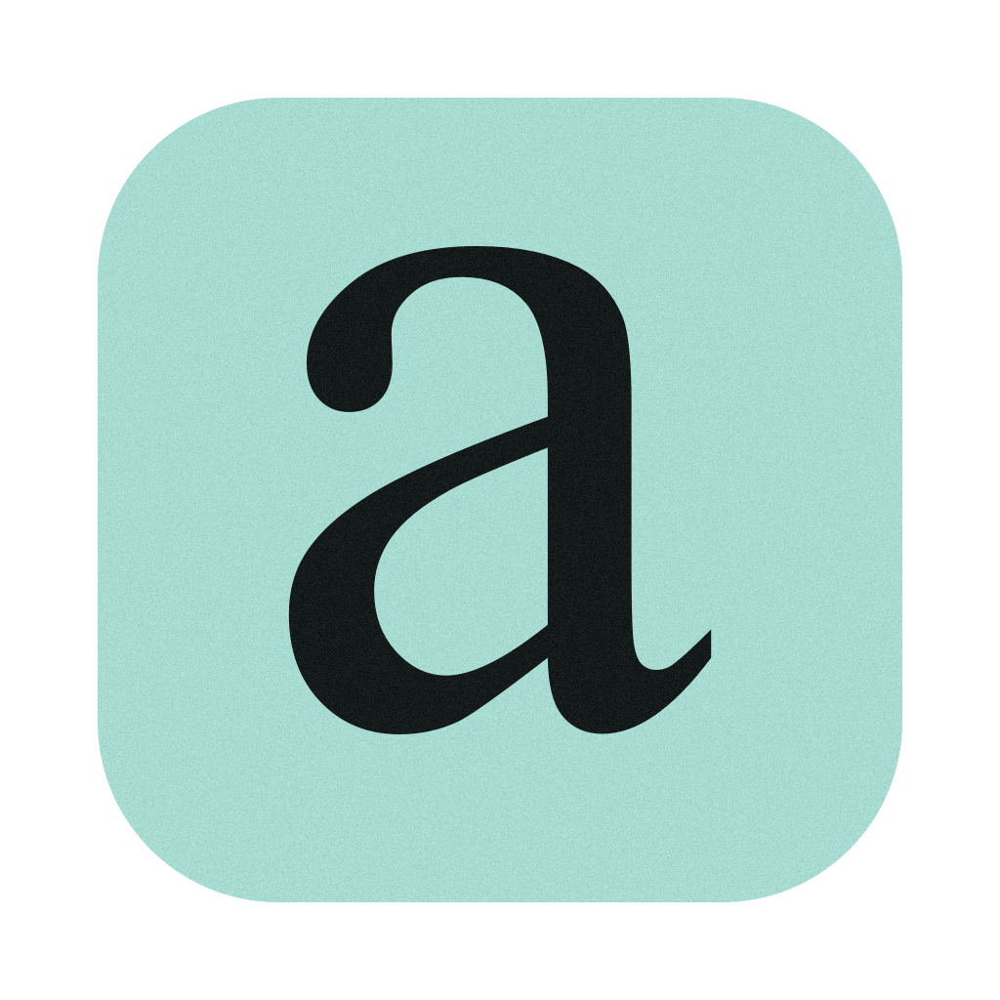
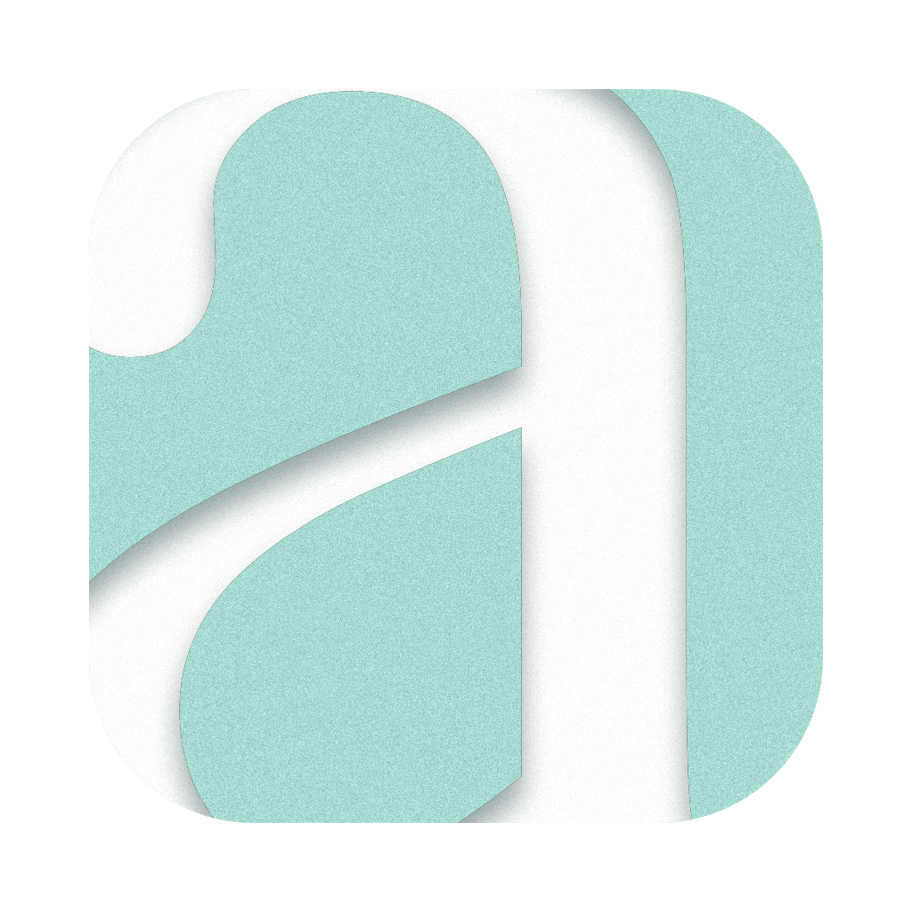

# ascend design

Visual identity for ascend, the offline-first nutrition tracker. Flat colour, Times for display, no gradients.

> [!NOTE]
> ascend started as a desktop browser. The window template and style guide
> below come from that project and are kept unchanged as design history. The
> app screens are designed next in FigCraft (`figcraft/`, Phase 2).

| File                                                               | What it is                                                                |
| ------------------------------------------------------------------ | ------------------------------------------------------------------------- |
| [`tokens.json`](tokens.json)                                       | Source of truth for colors, light/dark theme, type, spacing, radii, sizes |
| [`logo/ascend-icon.svg`](logo/ascend-icon.svg)                     | App icon source: cropped white Times “a”, Big Sur grid (824 px tile)      |
| [`history/`](history/)                                             | Every earlier design version, kept to show how the identity evolved       |
| [`logo/ascend-mark.svg`](logo/ascend-mark.svg)                     | The “a” alone on transparent background (start page, about box, README)   |
| [`template/ascend-window.svg`](template/ascend-window.svg)         | Browser-era window template (history): tabs, toolbar, side panel          |
| [`template/ascend-styleguide.svg`](template/ascend-styleguide.svg) | Six-colour palette and type scale; components from the browser era        |
| `export/*.png`                                                     | PNG renders of the files above                                            |
| `export/ascend-icon-web-1024.png`                                  | Full-bleed square icon for iPhone and PWA (no margin, corners or shadow)  |
| [`scripts/render-icon.swift`](scripts/render-icon.swift)           | Renders the icon and mark PNGs with exact glyph size and grain            |
| [`../build/icon.icns`](../build/icon.icns)                         | macOS icon (16–1024 px, @1x/@2x), kept from the browser era               |

## Concept

- **Mark:** an oversized white Times New Roman “a”, cropped by a flat mint
  tile on the right and at the bottom, so you can only guess the letter from
  its arch and bowl. An inner shadow presses it into the tile. Film grain
  is strong on the mint and only light on the white “a”.
- **Colour:** six flat colours, each with one job (see `tokens.json`). Paper
  and ink carry the interface. Teal marks links, focus and secure state.
  Mint appears only in the icon and selections. No gradients anywhere.
- **Type:** Times New Roman for display (the mark, wordmark, start page), SF
  Pro for the interface. Both ship with macOS, so nothing is downloaded
  (no CDN). Times and dates use tabular figures.
- **Texture:** grain only on the icon and mark, never on UI text.
- **Layout:** hairlines instead of shadows and cards; no promotional numbers
  or decorative tiles. (The browser-era template applied this to a start
  page; the app screens follow the same rule.)
- **Accessibility:** every text pair meets WCAG AA (body text ≥ 4.5:1).

## Evolution

Earlier versions stay in [`history/`](history/), so you can see how the
identity got here.

| Version | Icon                                                           | What changed                                                                  |
| ------- | -------------------------------------------------------------- | ----------------------------------------------------------------------------- |
| v0.1    |    | Two rising chevrons on a mint-to-blue gradient. Too generic.                  |
| v0.2    |    | A small Times “a” with grain, still on a gradient, with stat cards in the UI. |
| v0.3    |    | Flat colour, no gradients. A large ink “a”; the UI drops cards for hairlines. |
| v0.4    |    | The “a” turns white, outgrows the tile and gets an inner shadow.              |
| v0.5    |    | Larger still and cropped at the bottom: only the arch and bowl remain.        |
| v0.5.1  |  | More grain in the mint tile; the white “a” stays clean. Current.              |

Window and style guide renders for v0.1 to v0.3 are in the same folders; v0.4
to v0.5.1 changed only the icon.

### Font license note

Times New Roman is a Monotype font bundled with macOS. Rendering it into the
icon and screenshots is fine for this project. Before a public release, check
Monotype's terms for using it in a logo, or switch to the metric-compatible
Tinos (Apache-2.0), which looks almost identical.

## Using the files in DesignCraft

[DesignCraft](https://github.com/storytold/designcraft) (MIT / Apache-2.0)
saves native `.designcraft` documents (from v0.9.0). Until its CLI is set up,
import or drag in:

- the **SVG** files for editable vector layers (each region is a named group,
  e.g. `tab-strip`, `address-bar`, `side-panel`), or
- the **PNG** files in `export/` as a flat reference layer.

Planned: register `designcraft-cli mcp` for this project (read root
`design/`, write root `design/designcraft/`) so the templates can be built
directly as `.designcraft` files. When you change colors in DesignCraft,
update `tokens.json` too, so the app's CSS stays in sync.

## Regenerating exports (macOS built-in tools only)

```sh
# Icon and mark with grain (Swift + AppKit, deterministic output)
swift design/scripts/render-icon.swift design/export
# Templates
cd design
sips -s format png template/ascend-window.svg --out export/ascend-window.png
sips -s format png template/ascend-styleguide.svg --out export/ascend-styleguide.png
```

`sips` ignores SVG filters, so only the Swift-rendered icon and mark PNGs
show the grain. To rebuild `build/icon.icns`, scale the
1024 PNG to 16, 32, 128, 256 and 512 px (plus @2x) into an `ascend.iconset`
folder with `sips -z` and run `iconutil -c icns ascend.iconset`.

### Web app icons

The script also writes `export/ascend-icon-web-1024.png`: the same white "a"
at the same position, but the mint fills the whole square (no transparent
margin, no rounded corners, no drop shadow). iOS fills transparent pixels
with black and rounds the corners itself, and maskable PWA icons must cover
the full canvas. Inside the maskable safe zone (a centred circle with 80 % of
the width) you see about what the macOS tile shows.

After changing it, scale it into the app's icons (macOS only, uses `sips`):

```sh
npm run icons   # writes public/icons/{icon-192,icon-512,apple-touch-icon-180}.png
```

The PNGs in `public/icons/` are committed; the build never regenerates them.
`icon-512.png` serves as both the "any" and the "maskable" manifest icon.
